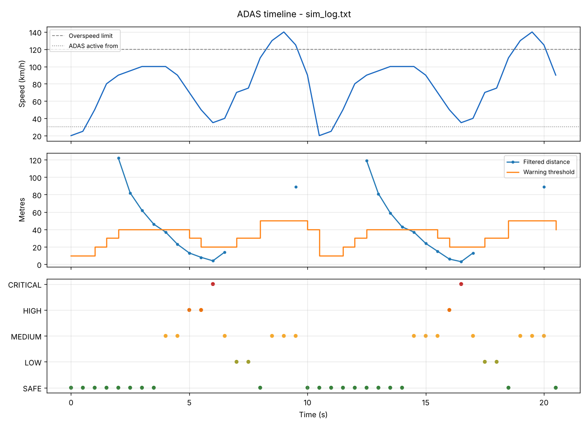

# STM32 Mini ADAS Subsystem (FreeRTOS + CAN)

A small ADAS ECU prototype on an **STM32F103C8T6 (Blue Pill)**: FreeRTOS tasks
process (simulated) sensor data, evaluate lane-departure / obstacle /
overspeed risk, drive a warning LED, exchange data over **CAN at 500 kbit/s**
and supervise their own health. The decision logic is plain C shared between
the firmware and a **PC Software-in-the-Loop (SIL) test suite**, so the tests
exercise exactly the code that runs on the MCU.

> Sensor inputs are currently produced by a deterministic drive scenario
> (no physical sensors yet). CAN runs in **silent loopback** by default so the
> full CAN path can be tested on a bare board without a transceiver.

---

## Architecture

```
            sensorQueue               alertQueue
SensorTask ────────────► DecisionTask ──────────► AlertTask ──► PA5 warning LED
 (500 ms)   │             adas_evaluate()   │
            │ CAN 0x100                     │ CAN 0x200
            ▼                               ▼
          canTxQueue ──► CAN_TxTask ──► bxCAN ──(loopback / bus)──► RX FIFO0 IRQ
                                                                    │ canRxQueue
                                                                    ▼
                                                               CAN_RxTask (decode, verify)
HealthMonitorTask (1 s): heartbeats, stack, heap, queue drops, CAN errors ──► CAN 0x300, PC13 LED
LoggerTask: the only task that writes to USART1 (all others post lines to logQueue)
```

| Task | Priority | Stack | Trigger | Responsibility |
|---|---|---|---|---|
| HealthMonitorTask | High | 1 KB | every 1 s | liveness, stack/heap watermarks, CAN error state, 0x300 status |
| DecisionTask | AboveNormal | 1 KB | sensorQueue | runs `adas_evaluate()`, sends alerts + CAN 0x200 |
| SensorTask | Normal | 1 KB | every 500 ms (`osDelayUntil`) | scenario + noise + fail-safe filter, CAN 0x100 |
| AlertTask | Normal | 1 KB | alertQueue / 100 ms | LED pattern per risk, alert messages on change |
| CAN_TxTask | Normal | 1 KB | canTxQueue | owns the 3 TX mailboxes |
| CAN_RxTask | Normal | 1 KB | canRxQueue | decodes and validates received frames |
| LoggerTask | Low | 1 KB | logQueue | UART output at 115200 baud |

### ADAS decision logic (`Core/Src/adas_logic.c`)

* ADAS active from **30 km/h**; below that no warnings (parking / traffic jam).
* Obstacle threshold depends on speed: ≤30 → 10 m, ≤50 → 20 m, ≤80 → 30 m, ≤100 → 40 m, above → 50 m.
* Risk = worst contribution:

| Risk | Condition | Action |
|---|---|---|
| SAFE | no warning | – |
| LOW | lane departure | Stay alert |
| MEDIUM | overspeed (>120 km/h) or obstacle inside threshold | Reduce speed |
| HIGH | obstacle closer than half the threshold | Slow down immediately |
| CRITICAL | obstacle ≤ 5 m | APPLY BRAKES! |

* **Fail-safe distance filter:** output = min(raw, 4-sample moving average). A plain
  average lagged so much that an approach to 4 m was reported as ~12 m (MEDIUM
  instead of CRITICAL); this filter reacts immediately to a closing gap and only
  smooths noise while the target moves away.

### CAN messages (`Core/Inc/adas_can.h`, standard 11-bit IDs, little endian)

| ID | Name | DLC | Content | Period |
|---|---|---|---|---|
| 0x100 | SENSOR_DATA | 4 | lane, distance_m, speed_kmh, seq | 500 ms |
| 0x200 | DECISION_ALERT | 3 | warning flags, risk level, seq | 500 ms |
| 0x300 | SYSTEM_STATUS | 6 | state, error flags, uptime_s, min heap/64, seq | 1 s |

Bit timing: APB1 8 MHz, prescaler 1, 1+13+2 = 16 tq → **500 kbit/s, sample point 87.5 %**.
RX is interrupt driven (`USB_LP_CAN1_RX0_IRQn`, priority 5 so FreeRTOS `FromISR` calls are legal);
the ISR only copies frames into a queue.

### Health monitoring

Each task increments a heartbeat counter. Every second the HealthMonitorTask
checks: stalled tasks (no heartbeat for 3 s), minimum free stack (< 128 B),
minimum free heap (< 512 B), queue overflows, CAN bus-off / TEC > 127 / TX
errors, and — in loopback mode — that transmitted frames are received back.
The result is printed, sent as CAN 0x300 and mirrored in `g_adas_debug`.
Stack overflow and heap exhaustion trap in FreeRTOS hooks; `Error_Handler`
and fault handlers halt in the debugger (`BKPT`) when one is attached.

---

## Hardware

| Item | Notes |
|---|---|
| STM32F103C8T6 "Blue Pill" | 64 KB flash, 20 KB RAM, internal 8 MHz HSI used (no crystal dependency) |
| ST-LINK V2 | SWDIO, SWCLK, GND, 3V3 (+ NRST recommended) |
| LED + 330 Ω on **PA5** | alert output (off / solid / 2.5 Hz / 5 Hz blink by risk) |
| On-board LED **PC13** | alive blink 1 Hz; fast blink = `Error_Handler` |
| USB-UART adapter (optional) | PA9 = TX → adapter RX, 115200 8N1 |
| CAN transceiver (optional) | TJA1050 / SN65HVD230 on PA11 (RX) / PA12 (TX); set CAN mode to *Normal* in CubeMX |

## Build, flash and debug (STM32CubeIDE)

1. *File → Import → Existing Projects into Workspace* → select `Mini_ADAS_RTOS`.
2. *Project → Build* (Debug configuration).
3. Connect ST-LINK and start **Run → Debug** with `Mini_ADAS_RTOS.launch`.
4. Watch the system without a UART adapter: *Window → Show View → Live Expressions*, add `g_adas_debug`.
5. With a UART adapter: open a terminal at **115200 baud**. Expected start:

```
=== STM32 Mini ADAS (FreeRTOS + CAN) ===
Build Nov  7 2026 00:40:00 | SYSCLK 8000000 Hz | reset: NRST PIN
CAN mode: SILENT LOOPBACK (no transceiver needed), 500 kbit/s
DATA,1,0,255,20,10,0,0,0,SAFE
CAN RX OK 0x100 SENSOR seq=0 dist=255 spd=20
CAN RX OK 0x200 ALERT seq=0 risk=SAFE
...
ALERT: risk=CRITICAL action="APPLY BRAKES!" [OBSTACLE]
HEALTH: up=5s heap_min=...B stack_min=...B(...) can tx=... rx=... err=0 drops=0
```

Code generation is safe: all application code lives in `app_*.c` / `adas_*.c`
and is called from `USER CODE` sections in `main.c`, so *Generate Code* in
CubeMX does not overwrite it.

**Memory (Debug build, approx.):** flash ≈ 20–25 KB of 64 KB, RAM ≈ 17.6 KB of 20 KB
(including a 12 KB FreeRTOS heap; tasks + queues use ≈ 10.2 KB of it).

---

## Software-in-the-Loop tests (`ADAS_Testing/`)

```
cd ADAS_Testing
make test                 # Windows MinGW: mingw32-make test
```

* `test.c` links the firmware's `adas_logic.c` and `adas_can.c`.
* 25 scenario cases in `test_cases.csv` (incl. all threshold boundaries),
  checked for warning flag **and** risk level → `log.csv`.
* Unit tests for the distance filter and CAN pack/unpack (round trips and
  rejection of wrong ID / DLC / invalid values). Current result: **219 checks, 0 failures**.
* `make adas_sim && ./adas_sim > sim_log.txt` runs the firmware scenario on the PC.
* `python plot.py sim_log.txt` → `screenshots/test_results.png`, `screenshots/timeline.png`.
* `streamlit run dashboard.py` → interactive view of a UART capture, the simulation output and the test results.



---

## Repository structure

```
Mini_ADAS_RTOS/            STM32CubeIDE project (open the .ioc in CubeMX)
  Core/Src/adas_logic.c    decision logic + filter      (shared with SIL tests)
  Core/Src/adas_can.c      CAN message pack/unpack      (shared with SIL tests)
  Core/Src/app_tasks.c     Sensor, Decision, Alert, HealthMonitor tasks
  Core/Src/app_can.c       CAN filter/start, TX task, RX ISR + task
  Core/Src/app_log.c       queue-based logger task
  Core/Src/main.c          CubeMX init + task creation
ADAS_Testing/              SIL tests, plots, Streamlit dashboard
simulation/                PC simulation of the firmware pipeline
```

## Limitations and next steps

* Sensors are simulated; next: ultrasonic/LiDAR (TF-Luna) driver feeding `SensorTask`.
* Verified by compilation, linking and SIL tests; CAN has only been exercised in loopback,
  not yet on a physical bus with a second node.
* Clock is the internal 8 MHz HSI; 72 MHz via HSE + PLL is possible on boards with a crystal.
* No independent watchdog yet (IWDG with debug-freeze is the next robustness step).
* Educational prototype, not developed to ISO 26262.

## Author

Mohit Babu Pasam — mohitbabuuol@gmail.com
